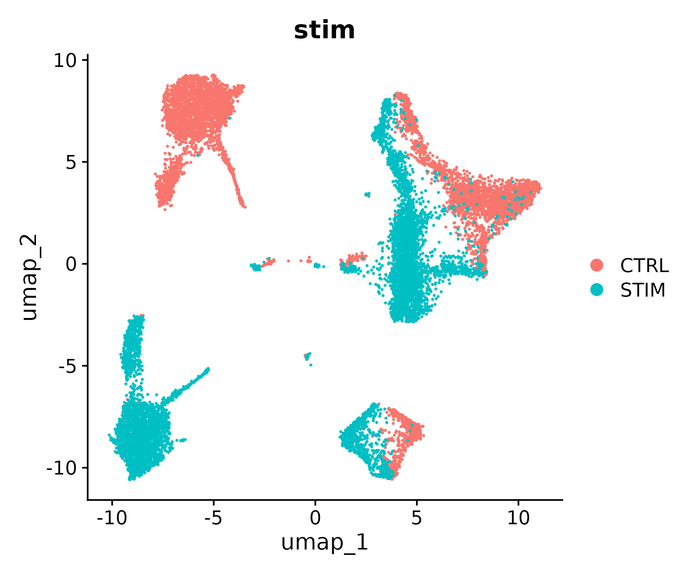
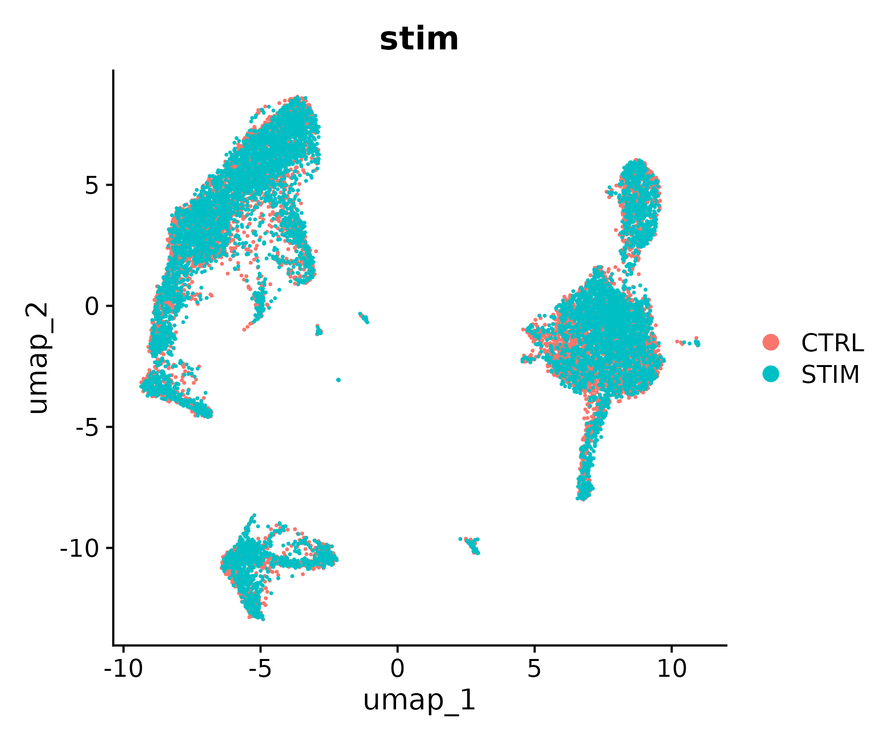
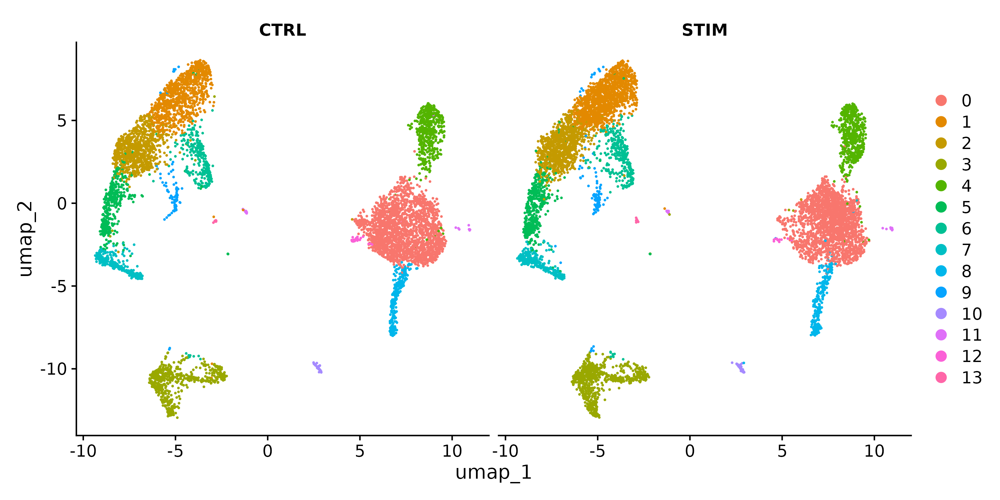
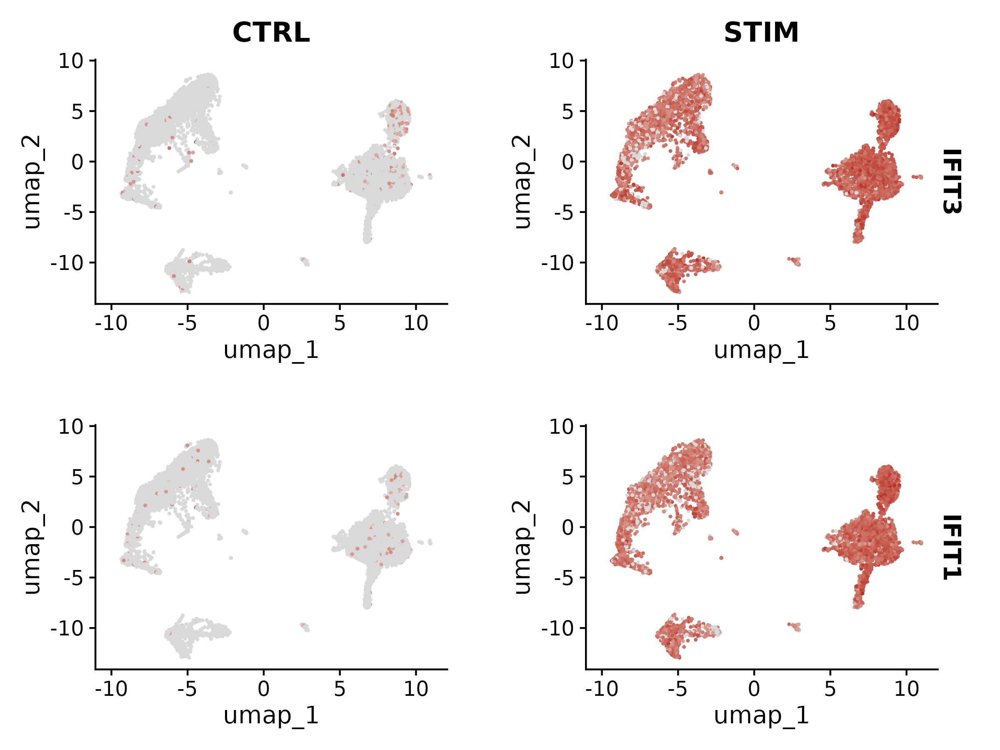
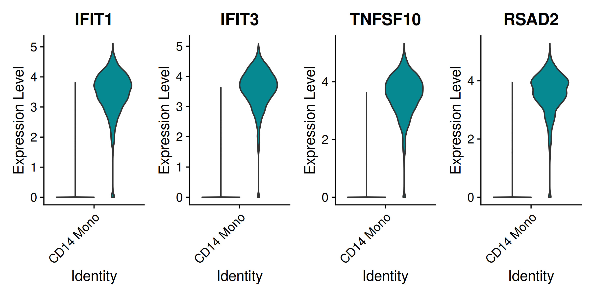
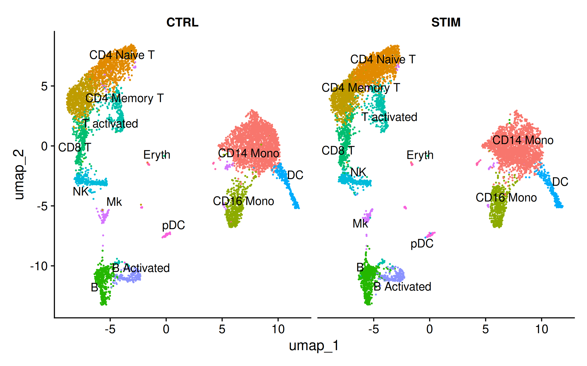

:::::::::::::::::::::::::::::::::::::: questions

- Why do cells from different samples cluster separately even when they are the same cell type?
- How does CCA-based integration correct for batch effects?
- How do we evaluate whether integration was successful without removing real biology?
- How do we find genes that differ between conditions within a specific cell type?
- When should we NOT integrate datasets?

::::::::::::::::::::::::::::::::::::::::::::::::

::::::::::::::::::::::::::::::::::::: objectives

- Explain the batch effect problem and why simple merging is insufficient
- Integrate two conditions using Seurat v5 CCA integration with IntegrateLayers
- Evaluate integration by checking condition mixing and preserved marker expression
- Identify conserved markers and condition-specific differentially expressed genes
- Recognize when integration is inappropriate for the experimental design

::::::::::::::::::::::::::::::::::::::::::::::::

::::::::::::::::::::::::::::::::::::::: prereq

## Prerequisites

This episode requires an RStudio session on the Negishi cluster. Launch
**RStudio (bioconductor)** under **Bioinformatics Apps** on
[Open OnDemand](https://gateway.negishi.rcac.purdue.edu) as described in the
[Setup](../learners/setup.md#starting-rstudio-on-open-ondemand) instructions.

:::::::::::::::::::::::::::::::::::::::

## Setup


``` r
library(Seurat)
library(SeuratData)
library(ggplot2)
library(patchwork)
```

Set up the working directory to match the previous episodes:


``` r
work_dir <- paste0(
    "/scratch/negishi/", Sys.getenv("USER"),
    "/scrna_workshop/"
)
setwd(work_dir)
```

## Why Integration Is Needed

In the previous episodes, we analyzed a single sample of PBMCs. But many
experimental designs involve **multiple samples** -- different patients,
different time points, or different conditions (treated vs. control). When we
combine these samples for joint analysis, a common problem emerges: cells
cluster by **which sample they came from** rather than by **what cell type they
are**.

This happens because of **batch effects**: technical differences between samples
caused by variation in cell handling, library preparation, sequencing depth,
or reagent lots. These technical differences can be large enough to dominate
over the biological differences between cell types, making it impossible to
compare the same cell type across conditions.

**Integration** algorithms correct for batch effects by finding shared
biological structure across samples. The goal is to align the same cell types
so they co-cluster, while preserving the real biological differences (like
changes in gene expression due to treatment).

Let's see this problem in practice using a dataset of PBMCs from control and
IFN-beta stimulated conditions.


## Loading the IFNB Dataset

The IFNB dataset from the `SeuratData` package contains PBMCs from two
conditions:

- **CTRL**: untreated control PBMCs
- **STIM**: PBMCs stimulated with interferon-beta (IFN-beta), a cytokine that
  activates antiviral immune responses


``` r
InstallData("ifnb")
ifnb <- LoadData("ifnb")
ifnb
```

:::::::::::::::::::::::::::::::::::::::::: spoiler

## Expected output

```
An object of class Seurat
14053 features across 13999 samples within 1 assay
Active assay: RNA (14053 features, 0 variable features)
 2 layers present: counts, data
```

The dataset has approximately 14,000 cells and 14,000 genes. The `stim` column
in the metadata records which condition each cell came from.

::::::::::::::::::::::::::::::::::::::::::::::::::


``` r
table(ifnb$stim)
```

:::::::::::::::::::::::::::::::::::::::::: spoiler

## Expected output

```
CTRL STIM
6548 7451
```

Roughly 6,500 control cells and 7,500 stimulated cells.

::::::::::::::::::::::::::::::::::::::::::::::::::


## Preparing Data

In Seurat v5, multi-sample data is handled by **splitting the assay into
layers** -- one layer per sample. This keeps everything in a single object
while allowing integration methods to process each sample separately.


``` r
ifnb[["RNA"]] <- split(ifnb[["RNA"]], f = ifnb$stim)
ifnb
```

:::::::::::::::::::::::::::::::::::::::::: spoiler

## Expected output

```
An object of class Seurat
14053 features across 13999 samples within 1 assay
Active assay: RNA (14053 features, 0 variable features)
 4 layers present: counts.CTRL, counts.STIM, data.CTRL, data.STIM
```

The counts are now stored in two separate layers: `counts.CTRL` and
`counts.STIM`.

::::::::::::::::::::::::::::::::::::::::::::::::::

Now run the standard preprocessing steps. When the assay is split,
`NormalizeData` and `FindVariableFeatures` process each layer independently:


``` r
ifnb <- NormalizeData(ifnb)
ifnb <- FindVariableFeatures(ifnb, selection.method = "vst", nfeatures = 2000)
ifnb <- ScaleData(ifnb)
ifnb <- RunPCA(ifnb)
```

Let's see what happens if we run UMAP and clustering **without** integration:


``` r
ifnb <- FindNeighbors(ifnb, dims = 1:30, reduction = "pca")
ifnb <- FindClusters(ifnb, resolution = 0.5)
ifnb <- RunUMAP(ifnb, dims = 1:30, reduction = "pca")
```


``` r
DimPlot(ifnb, reduction = "umap", group.by = "stim")
```


{alt="UMAP plot of the IFNB dataset before integration showing CTRL and STIM cells forming separate clusters driven by batch effects rather than cell type identity."}

You should see a clear separation between control (CTRL) and stimulated (STIM)
cells. Instead of clustering by cell type (T cells with T cells, monocytes
with monocytes), the cells cluster by condition. This means we cannot directly
compare the same cell type between conditions -- which is exactly what we
want to do. This is the batch effect problem.


## Running Integration

Seurat v5 provides `IntegrateLayers()` as a unified interface for dataset
integration. We will use the **CCA (Canonical Correlation Analysis)** method,
which identifies shared sources of variation between the two conditions and
uses them to align the data.

CCA works by:

1. Finding **canonical correlation vectors** -- directions in gene expression
   space along which the two datasets are maximally correlated
2. Identifying **anchor pairs** -- cells from different conditions that are
   each other's mutual nearest neighbors in the shared CCA space
3. Using the anchors to compute a **correction vector** that aligns matching
   cell types across conditions

[Animation: Why integrate, and what CCA integration does](files/animations/ep7_integration-anchors.html)


``` r
ifnb <- IntegrateLayers(object = ifnb,
                        method = CCAIntegration,
                        orig.reduction = "pca",
                        new.reduction = "integrated.cca")
```

| Parameter | Value | Description |
|-----------|-------|-------------|
| `method` | `CCAIntegration` | Use Canonical Correlation Analysis for integration. |
| `orig.reduction` | `"pca"` | The unintegrated PCA reduction to use as input. |
| `new.reduction` | `"integrated.cca"` | Name for the new integrated reduction that will be stored in the object. |

Now re-run the downstream steps using the **integrated** reduction instead
of the original PCA:


``` r
ifnb <- FindNeighbors(ifnb, reduction = "integrated.cca", dims = 1:30)
ifnb <- FindClusters(ifnb, resolution = 0.5)
ifnb <- RunUMAP(ifnb, reduction = "integrated.cca", dims = 1:30)
```

Visualize the integrated result:


``` r
DimPlot(ifnb, reduction = "umap", group.by = "stim")
```
{alt="UMAP plot of the IFNB dataset after CCA integration showing control and stimulated cells intermingled within each cluster, indicating successful batch correction."}

The control and stimulated cells should now be intermingled within each
cluster. Cell types from both conditions co-cluster, which is what we want.

Let's verify with a split view:


``` r
DimPlot(ifnb, reduction = "umap", split.by = "stim")
```
{alt="Split UMAP view showing CTRL and STIM conditions side by side after integration, with both panels displaying the same 14 clusters in identical spatial arrangement."}

Both panels should show the same overall structure, with the same clusters
present in both conditions. This confirms that integration successfully
aligned shared cell types.

Before proceeding to analysis, rejoin the layers so that expression data
from both conditions is accessible in a single matrix:


``` r
ifnb[["RNA"]] <- JoinLayers(ifnb[["RNA"]])
```

:::::::::::::::::::::::::::::::::::::::::: callout

## Other integration methods

Seurat v5 supports several integration methods through the same
`IntegrateLayers()` interface. You can swap `CCAIntegration` for any of these:

| Method | Function | Strengths |
|--------|:---------|:----------|
| **CCA** | `CCAIntegration` | Best for datasets with shared cell types. Robust to differences in cell type composition between batches. The default choice for most experiments. |
| **Harmony** | `HarmonyIntegration` | Very fast, scales well to large datasets (100k+ cells). Uses iterative soft clustering. Requires the `harmony` R package. Widely used and well-benchmarked. |
| **RPCA** | `RPCAIntegration` | Faster than CCA (uses reciprocal PCA instead of full CCA). Good when datasets are large or when CCA is too slow. May be less robust when cell type composition differs substantially between batches. |
| **scVI** | `scVIIntegration` | Deep learning approach. Excellent for complex batch structures (many batches, large composition differences). Requires Python and the `scvi-tools` package. Slower to run but often produces superior results on difficult datasets. |

For most standard experiments with two to five batches and shared cell types,
**CCA** or **Harmony** work well. Use **scVI** for more complex scenarios
(many batches, different tissues, cross-species integration).

:::::::::::::::::::::::::::::::::::::::::::::::::::

:::::::::::::::::::::::::::::::::::::::::: callout

## When NOT to integrate

Integration assumes that the same cell types exist in all batches and aligns
them. This is the wrong approach when:

- **All cells are expected to differ** between conditions. For example,
  comparing tumor cells to normal epithelial cells -- these are fundamentally
  different populations and should not be forced to co-cluster.
- **You want to find condition-specific cell types.** Integration pushes
  cells together, which can mask the appearance of a cell state that exists
  in only one condition.
- **The batch effect is minimal.** If cells already mix well by condition on
  the UMAP (as in some well-controlled experiments), integration is
  unnecessary and may introduce artifacts.

Always visualize the data **before integration** to assess whether batch
effects are actually present. If conditions already mix well, skip integration
and analyze directly.

:::::::::::::::::::::::::::::::::::::::::::::::::::


## Analysis on Integrated Data

Now that the data is integrated, we can label cell types and compare
between conditions.

### Cell type labels

The ifnb object comes with cell type labels: the `seurat_annotations` column
in its metadata, assigned by the Seurat developers from marker genes. We use
them as our cell types instead of labelling the 14 integrated clusters by
hand. Episode 6 showed the manual approach, and Challenge 3 at the end of this
episode repeats it on these clusters.


``` r
# Use the cell type labels that ship with the ifnb dataset
ifnb$celltype <- ifnb$seurat_annotations
Idents(ifnb) <- "celltype"
table(ifnb$celltype)
```

:::::::::::::::::::::::::::::::::::::::::: spoiler

## Expected output

```output
   CD14 Mono  CD4 Naive T CD4 Memory T    CD16 Mono            B        CD8 T 
        4362         2504         1762         1044          978          814 
 T activated           NK           DC  B Activated           Mk          pDC 
         633          619          472          388          236          132 
       Eryth 
          55 
```

Thirteen cell types. They are finer than the ten of episode 6 in some places
(naive and memory CD4 T cells, resting and activated B cells, an activated T
cell group) and include megakaryocytes (Mk, the platelet precursors) and a few
erythrocytes (Eryth). CD16 Mono are the FCGR3A+ monocytes of episode 6
(FCGR3A is the gene that encodes CD16).

::::::::::::::::::::::::::::::::::::::::::::::::::

### Checking the integration against the labels

The labels were assigned independently of our integration, so they give a
check on it: if integration grouped cells by type, each integrated cluster
should consist mostly of one cell type, drawn from both conditions.


``` r
table(cluster = ifnb$seurat_clusters, celltype = ifnb$celltype)
```

:::::::::::::::::::::::::::::::::::::::::: spoiler

## Expected output

```output
       celltype
cluster CD14 Mono CD4 Naive T CD4 Memory T CD16 Mono    B CD8 T T activated
     0       4272           0            0        16    1     0           0
     1          0        2332           47         1    1     9          20
     2          5         132         1643         0    0    30          16
     3          0           0            0         0  975     1          15
     4         28           0            0      1027    0     0           0
     5          1           2           51         0    0   765           7
     6          0          38            8         0    0     1         575
     7          0           0            0         0    0     8           0
     8         48           0            0         0    0     0           0
     9          0           0           13         0    1     0           0
     10         0           0            0         0    0     0           0
     11         3           0            0         0    0     0           0
     12         5           0            0         0    0     0           0
     13         0           0            0         0    0     0           0
       celltype
cluster   NK   DC B Activated   Mk  pDC Eryth
     0     0    4           1    2    0     0
     1     0    0           0    6    0     0
     2     1    0           0    1    0     0
     3     0    0         387    0    0     1
     4     0    0           0   13    0     0
     5     9    0           0    0    0     0
     6     0    0           0    0    1     0
     7   608    0           0    0    0     0
     8     0  466           0    0    1     0
     9     1    0           0  175    0     0
     10    0    2           0    0  106     0
     11    0    0           0    0    0    54
     12    0    0           0   39    0     0
     13    0    0           0    0   24     0
```

Almost every cluster is dominated by one cell type: cluster 0 is CD14
monocytes, 3 is B cells (resting and activated together), 4 is CD16
monocytes, 5 CD8 T cells, 7 NK cells, 8 dendritic cells, 10 pDCs and 11
erythrocytes. Clusters 1 and 2 split the CD4 T cells into mostly naive and
mostly memory cells, and the megakaryocytes fall into two small clusters (9
and 12). A cluster that mixed, say, T cells and monocytes would point to an
integration or clustering problem. Together with the split view above, which
shows every cluster in both conditions, this confirms the integration.

::::::::::::::::::::::::::::::::::::::::::::::::::


``` r
DimPlot(ifnb, reduction = "umap", label = TRUE, repel = TRUE) + NoLegend()
```
{alt="Annotated UMAP plot of the integrated IFNB dataset with thirteen labeled cell types: CD14 Mono, CD4 Naive T, CD4 Memory T, CD16 Mono, B, CD8 T, T activated, NK, DC, B Activated, Mk, pDC and Eryth."}


### Conserved markers

**Conserved markers** are genes that are markers for a cell type in **both**
conditions. `FindConservedMarkers()` tests for differential expression within
each condition separately and then combines the results:


``` r
conserved <- FindConservedMarkers(ifnb,
                                  ident.1 = "CD14 Mono",
                                  grouping.var = "stim",
                                  only.pos = TRUE)


head(conserved, 10)
```

| Parameter | Value | Description |
|-----------|-------|-------------|
| `ident.1` | `"CD14 Mono"` | The cell type to find markers for. |
| `grouping.var` | `"stim"` | The metadata column defining conditions. The test is run within each level of this variable. |
| `only.pos` | `TRUE` | Only return upregulated genes. |

The output has columns for each condition (e.g., `CTRL_avg_log2FC`,
`STIM_avg_log2FC`) showing that the marker is consistent across both. Genes
like S100A8, S100A9, TYROBP and FCER1G appear as strong conserved markers for
monocytes.

:::::::::::::::::::::::::::::::::::::::::: spoiler

## Expected output

```output
         CTRL_p_val CTRL_avg_log2FC CTRL_pct.1 CTRL_pct.2 CTRL_p_val_adj
C15orf48          0        3.056281      0.984      0.189              0
S100A8            0        5.231200      0.853      0.063              0
IL8               0        4.008658      0.911      0.133              0
TYROBP            0        2.505484      0.997      0.249              0
FCER1G            0        2.375142      0.992      0.251              0
S100A9            0        5.162259      0.795      0.060              0
CTSB              0        3.378535      0.873      0.174              0
TYMP              0        2.359353      0.961      0.272              0
SOD2              0        2.418683      0.963      0.276              0
S100A4            0        2.704430      0.953      0.270              0
         STIM_p_val STIM_avg_log2FC STIM_pct.1 STIM_pct.2 STIM_p_val_adj
C15orf48          0        3.110432      0.988      0.191              0
S100A8            0        6.080987      0.523      0.016              0
IL8               0        4.025185      0.343      0.025              0
TYROBP            0        2.550902      0.999      0.227              0
FCER1G            0        2.753517      0.991      0.210              0
S100A9            0        5.758266      0.686      0.030              0
CTSB              0        3.791644      0.944      0.174              0
TYMP              0        2.554257      0.998      0.441              0
SOD2              0        3.103627      0.991      0.319              0
S100A4            0        2.986390      0.928      0.186              0
         max_pval minimump_p_val
C15orf48        0              0
S100A8          0              0
IL8             0              0
TYROBP          0              0
FCER1G          0              0
S100A9          0              0
CTSB            0              0
TYMP            0              0
SOD2            0              0
S100A4          0              0
```

::::::::::::::::::::::::::::::::::::::::::::::::::


### Condition-specific differential expression

The most interesting biological question is: **which genes change between
control and stimulated cells within the same cell type?** To answer this, we
subset to a single cell type and compare conditions:


``` r
# Subset to CD14+ monocytes
mono <- subset(ifnb, idents = "CD14 Mono")

# Set the condition as the active identity
Idents(mono) <- "stim"

# Find DE genes between stimulated and control
mono.de <- FindMarkers(mono,
                       ident.1 = "STIM",
                       ident.2 = "CTRL",
                       min.pct = 0.25,
                       logfc.threshold = 0.25)
head(mono.de, 10)
```

:::::::::::::::::::::::::::::::::::::::::: spoiler

## Expected output

```output
        p_val avg_log2FC pct.1 pct.2 p_val_adj
IFIT1       0   7.319139 0.985 0.033         0
CXCL10      0   8.036564 0.984 0.035         0
RSAD2       0   6.741673 0.988 0.045         0
TNFSF10     0   6.991279 0.989 0.047         0
IFIT3       0   6.883785 0.992 0.056         0
IFIT2       0   7.179929 0.961 0.039         0
CXCL11      0   8.624208 0.932 0.012         0
CCL8        0   9.134191 0.918 0.017         0
IDO1        0   5.455898 0.965 0.089         0
MX1         0   5.059052 0.960 0.093         0
```

The top DE genes are **interferon-stimulated genes (ISGs)** such as IFIT1,
RSAD2, TNFSF10, IFIT3, IFIT2 and MX1, together with the IFN-inducible
chemokines CXCL10, CXCL11 and CCL8. These are exactly the genes you would
expect to be upregulated by IFN-beta stimulation, confirming that our
integration preserved the biological signal while correcting the batch
effect. The exact fold changes, and the number of genes that pass a
significance cutoff, vary slightly between Seurat versions; the leading ISGs
do not.

::::::::::::::::::::::::::::::::::::::::::::::::::


Save the annotated ifnb object for the next episode:


``` r
saveRDS(ifnb, file = "ifnb_annotated.rds")
```


### Visualizing condition-specific changes

Let's visualize a few ISGs to see the condition-specific response:


``` r
FeaturePlot(ifnb,
            features = c("IFIT3", "IFIT1"),
            split.by = "stim",
            cols = c("grey85", "firebrick"))
```

{alt="FeaturePlot of ISG genes split by condition showing near-absent expression in CTRL panels and strong red expression in STIM panels, especially in monocyte clusters."}


``` r
VlnPlot(ifnb,
        features = c("IFIT1", "IFIT3", "TNFSF10", "RSAD2"),
        split.by = "stim",
        idents = "CD14 Mono",
        ncol = 4,
        pt.size = 0)
```

{alt="Violin plots of IFIT1, IFIT3, TNFSF10, and RSAD2 in CD14 monocytes showing flat expression in control and broad high expression in stimulated cells."}

IFIT1 and IFIT3 are strongly induced in the stimulated condition across
multiple cell types, with particularly strong expression in monocytes. This
demonstrates that integration corrected the batch effect (cell types co-cluster)
while preserving the biological effect of IFN-beta stimulation (ISGs are still
differentially expressed).


::::::::::::::::::::::::::::::::::::: challenge

## Challenge 1: Quantifying integration quality

After integration, check whether control and stimulated cells of the same type
are well mixed within each cluster. Use `DimPlot(split.by = "stim")` to
visualize, then compute the proportion of each condition per cluster.


``` r
# Split UMAP by condition
DimPlot(ifnb, reduction = "umap", split.by = "stim", label = TRUE, repel = TRUE) +
    NoLegend()

# Proportion table: condition per cell type
prop.table(table(Condition = ifnb$stim, CellType = Idents(ifnb)), margin = 2)
```

Are the proportions roughly balanced (close to 50/50) within each cell type?

:::::::::::::::::::::::: solution

## Solution

```output
         CellType
Condition CD14 Mono CD4 Naive T CD4 Memory T CD16 Mono         B     CD8 T
     CTRL 0.5077946   0.3905751    0.4875142 0.4856322 0.4161554 0.4324324
     STIM 0.4922054   0.6094249    0.5124858 0.5143678 0.5838446 0.5675676
         CellType
Condition T activated        NK        DC B Activated        Mk       pDC
     CTRL   0.4739336 0.4814216 0.5466102   0.4768041 0.4872881 0.3863636
     STIM   0.5260664 0.5185784 0.4533898   0.5231959 0.5127119 0.6136364
         CellType
Condition     Eryth
     CTRL 0.4181818
     STIM 0.5818182
```

{alt="Split UMAP showing CTRL and STIM panels with cell type labels, demonstrating balanced mixing of conditions within each annotated cell type."}

Most cell types fall in the **0.40--0.60** range, and the split UMAP shows
every cell type in both panels with similar density. The baseline is not
50/50: STIM has 7,451 of the 13,999 cells (53%), so about 0.47 CTRL and 0.53
STIM is what perfect mixing looks like here.

Some observations worth discussing:

- **CD14 Mono**, the largest population, is close to the baseline
  (50.8/49.2).
- **CD4 Naive T and pDC** show the largest deviation (about 39/61), with more
  cells in the stimulated condition. This could reflect a real biological
  shift in culture rather than a failure of integration; a few percentage
  points either way are well within what two samples of one experiment give.
- **Rare populations** (Mk, Eryth, pDC) have small cell numbers, so chance
  has more effect on their proportions.

The key diagnostic: if integration had failed, you would see a cell type that
is 90%+ from one condition, or the same cell type forming separate clusters
in the two panels. Neither is the case here.

:::::::::::::::::::::::::::::::::

::::::::::::::::::::::::::::::::::::::::::::::::


::::::::::::::::::::::::::::::::::::: challenge

## Challenge 2: Interferon response genes in monocytes

Find the top 10 differentially expressed genes between stimulated and control
**CD14+ monocytes** (we computed this above as `mono.de`). Are these genes
consistent with an interferon stimulation response?


``` r
# Top 10 upregulated genes in stimulated vs control CD14+ monocytes
top10_de <- head(mono.de[order(mono.de$avg_log2FC, decreasing = TRUE), ], 10)
print(top10_de)

# Visualize the top 4 genes
FeaturePlot(ifnb,
            features = rownames(top10_de)[1:4],
            split.by = "stim",
            ncol = 4,
            cols = c("grey85", "firebrick"))
```

:::::::::::::::::::::::: solution

## Solution

{alt="FeaturePlot of CCL8, CXCL11, HESX1, and CXCL10 split by condition showing absent expression in control and strong monocyte-concentrated expression in stimulated cells."}


```output
                p_val avg_log2FC pct.1 pct.2    p_val_adj
CCL8     0.000000e+00   9.134191 0.918 0.017  0.00000e+00
CXCL11   0.000000e+00   8.624208 0.932 0.012  0.00000e+00
HESX1   2.729040e-227   8.265045 0.388 0.001 3.83512e-223
CXCL10   0.000000e+00   8.036564 0.984 0.035  0.00000e+00
IFIT1    0.000000e+00   7.319139 0.985 0.033  0.00000e+00
IFIT2    0.000000e+00   7.179929 0.961 0.039  0.00000e+00
TNFSF10  0.000000e+00   6.991279 0.989 0.047  0.00000e+00
CD38    4.872419e-277   6.974732 0.464 0.005 6.84721e-273
IFIT3    0.000000e+00   6.883785 0.992 0.056  0.00000e+00
GMPR    4.371764e-244   6.765773 0.419 0.005 6.14364e-240
```

The top 10 genes fall into two functional categories, both consistent with
IFN-beta stimulation:

| Gene | log2FC | pct.1 / pct.2 | Function |
|------|:------:|:--------------|:---------|
| CCL8 | 9.13 | 0.92 / 0.02 | Chemokine; recruits monocytes and T cells to sites of inflammation |
| CXCL11 | 8.62 | 0.93 / 0.01 | IFN-inducible chemokine; attracts activated T cells via CXCR3 |
| HESX1 | 8.27 | 0.39 / 0.00 | Transcription factor; emerging role in IFN signaling |
| CXCL10 | 8.04 | 0.98 / 0.04 | IFN-inducible chemokine (IP-10); major recruiter of immune cells |
| IFIT1 | 7.32 | 0.99 / 0.03 | Directly induced by type I IFN; inhibits viral translation |
| IFIT2 | 7.18 | 0.96 / 0.04 | Antiviral effector; regulates translation during infection |
| TNFSF10 | 6.99 | 0.99 / 0.05 | TRAIL; IFN-induced death ligand that kills infected cells |
| CD38 | 6.97 | 0.46 / 0.01 | NAD-consuming enzyme induced by type I IFN in monocytes |
| IFIT3 | 6.88 | 0.99 / 0.06 | Antiviral effector; forms complex with IFIT1 and IFIT2 |
| GMPR | 6.77 | 0.42 / 0.01 | Guanosine monophosphate reductase; modulates purine metabolism |

Two patterns stand out:

**Chemokines dominate the top.** CCL8, CXCL11, and CXCL10 are three of the
top four, with fold changes of 8.0-9.1, reflecting the monocyte's primary role as a sentinel
cell: upon IFN stimulation, monocytes broadcast chemokine signals to recruit
other immune cells. Note the pct.2 values (0.01-0.04) -- these chemokines are
essentially absent in control cells and massively induced by stimulation.

**Classical ISGs fill the rest.** IFIT1/2/3 and TNFSF10 are canonical
interferon-stimulated genes; CD38 and GMPR are induced in a subset of cells
(pct.1 0.42-0.46). The IFIT family shows the highest pct.1 values
(0.96-0.99), meaning nearly every stimulated monocyte expresses them -- a
hallmark of a robust, uniform interferon response.

The FeaturePlot confirms this visually: CCL8, CXCL11, HESX1, and CXCL10 are
virtually absent in the CTRL panels (gray) and strongly expressed in the STIM
panels (red), with the signal concentrated in the monocytes (right side of
the UMAP); HESX1 is induced in only a subset of them. CXCL10 also reaches the
stimulated B cells and is scattered through the T cells, consistent with
these cell types also responding to IFN-beta, though less strongly than
monocytes.

:::::::::::::::::::::::::::::::::

::::::::::::::::::::::::::::::::::::::::::::::::
::::::::::::::::::::::::::::::::::::: challenge

## Challenge 3: Label the integrated clusters yourself

We used the labels that ship with the dataset. Label the 14 integrated
clusters from marker genes instead, as in episode 6, and compare your labels
with `seurat_annotations`. Plot the canonical markers per cluster first, then
write one label per cluster.


``` r
Idents(ifnb) <- "seurat_clusters"
DotPlot(ifnb, features = c("CD3D", "IL7R", "CCR7", "CD8A", "GNLY", "NKG7",
                           "MS4A1", "CD79A", "CD14", "LYZ", "FCGR3A", "MS4A7",
                           "FCER1A", "LILRA4", "IL3RA", "PPBP", "HBB")) +
    coord_flip()
```

:::::::::::::::::::::::::::::::::::::::::: callout

## A label vector only fits the clusters it was written for

The solution below fits the 14 clusters this lesson's integration gives with
the package versions in the setup instructions. With other versions the
number or order of the clusters can change, and the names then land on the
wrong cells without any error. The code stops if the number of clusters does
not match the number of labels; it cannot detect a change in order, so check
your dot plot against the comment beside each label.

::::::::::::::::::::::::::::::::::::::::::::::::::

:::::::::::::::::::::::: solution

## Solution


``` r
# One label per integrated cluster, in cluster order (0 to 13)
my.labels <- c(
    "CD14 Mono",     # 0: CD14+, LYZ+, CST3+
    "CD4 Naive T",   # 1: CD3D+, CCR7 high
    "CD4 Memory T",  # 2: CD3D+, IL7R+, CCR7 lower
    "B",             # 3: MS4A1+, CD79A+
    "CD16 Mono",     # 4: FCGR3A+, MS4A7+
    "CD8 T",         # 5: CD3D+, CD8A+, NKG7+
    "T activated",   # 6: IL7R+, CCR7+, CD3D low
    "NK",            # 7: GNLY+, NKG7+, CD3D-
    "DC",            # 8: LYZ+, CST3+, FCER1A+
    "Mk",            # 9: PPBP+
    "pDC",           # 10: LILRA4+, IL3RA+
    "Eryth",         # 11: HBB+
    "Mk",            # 12: PPBP+, with monocyte genes
    "pDC"            # 13: no clear marker; the shipped labels say pDC
)
if (nlevels(ifnb$seurat_clusters) != length(my.labels)) stop("ifnb has ", nlevels(ifnb$seurat_clusters), " clusters but my.labels has ", length(my.labels), " labels; check the dot plot and edit my.labels")
names(my.labels) <- levels(ifnb$seurat_clusters)
ifnb$manual_celltype <- unname(my.labels[as.character(ifnb$seurat_clusters)])
table(Manual = ifnb$manual_celltype, Shipped = ifnb$celltype)
Idents(ifnb) <- "celltype"
```

```output
              Shipped
Manual         CD14 Mono CD4 Naive T CD4 Memory T CD16 Mono    B CD8 T
  B                    0           0            0         0  975     1
  CD14 Mono         4272           0            0        16    1     0
  CD16 Mono           28           0            0      1027    0     0
  CD4 Memory T         5         132         1643         0    0    30
  CD4 Naive T          0        2332           47         1    1     9
  CD8 T                1           2           51         0    0   765
  DC                  48           0            0         0    0     0
  Eryth                3           0            0         0    0     0
  Mk                   5           0           13         0    1     0
  NK                   0           0            0         0    0     8
  pDC                  0           0            0         0    0     0
  T activated          0          38            8         0    0     1
              Shipped
Manual         T activated   NK   DC B Activated   Mk  pDC Eryth
  B                     15    0    0         387    0    0     1
  CD14 Mono              0    0    4           1    2    0     0
  CD16 Mono              0    0    0           0   13    0     0
  CD4 Memory T          16    1    0           0    1    0     0
  CD4 Naive T           20    0    0           0    6    0     0
  CD8 T                  7    9    0           0    0    0     0
  DC                     0    0  466           0    0    1     0
  Eryth                  0    0    0           0    0    0    54
  Mk                     0    1    0           0  214    0     0
  NK                     0  608    0           0    0    0     0
  pDC                    0    0    2           0    0  130     0
  T activated          575    0    0           0    0    1     0
```

Each cluster gets the shipped label that most of its cells carry, so most
cells sit on the diagonal of the table. The off-diagonal cells are the ones a
cluster-level label cannot get right: activated B cells inside the B cell
cluster, the naive and memory CD4 T cells that the two CD4 clusters share, and
a few cells of other types in each cluster. Cluster 13 has no clear marker in
the dot plot; with only 24 cells, it is labelled pDC because the shipped
annotation says so. Two lessons: a cluster label is a statement about most
of its cells, not all of them, and a cluster without markers is a candidate
for removal rather than a cell type.

The last line sets the identities back to the shipped labels, so any code you
run afterwards uses the same cell types as the rest of the lesson.

:::::::::::::::::::::::::::::::::

::::::::::::::::::::::::::::::::::::::::::::::::

::::::::::::::::::::::::::::::::::::: keypoints

- Batch effects cause cells to cluster by sample rather than by cell type, preventing cross-condition comparisons
- CCA integration finds shared correlation structure between conditions and aligns matching cell types using anchor pairs
- In Seurat v5, multi-sample data is handled by splitting assay layers, integrating, then rejoining layers for downstream analysis
- Always verify integration by checking that conditions mix within clusters AND that known biological differences (like ISG expression) are preserved
- Integration is not always appropriate; skip it when conditions have no shared cell types or when batch effects are minimal

::::::::::::::::::::::::::::::::::::::::::::::::
